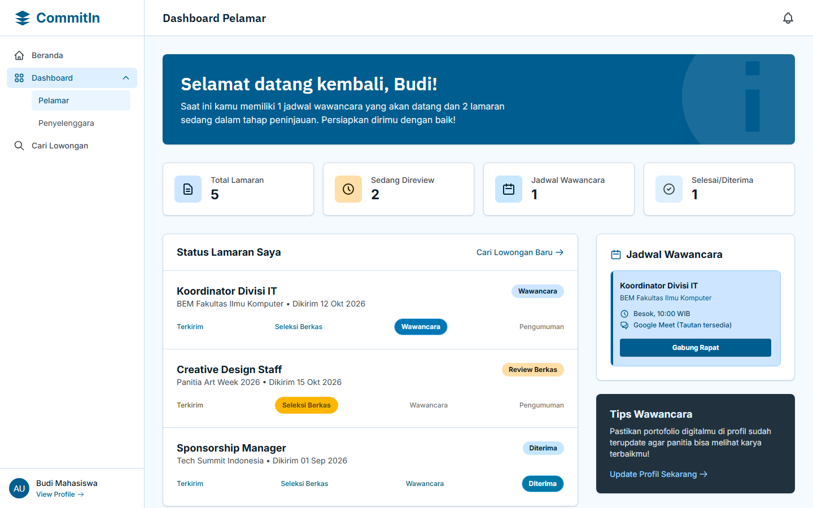
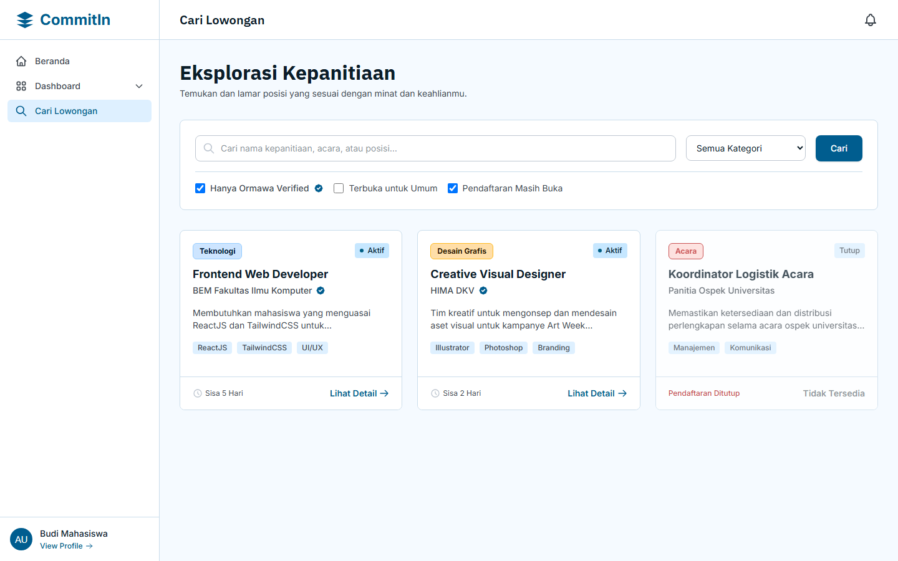
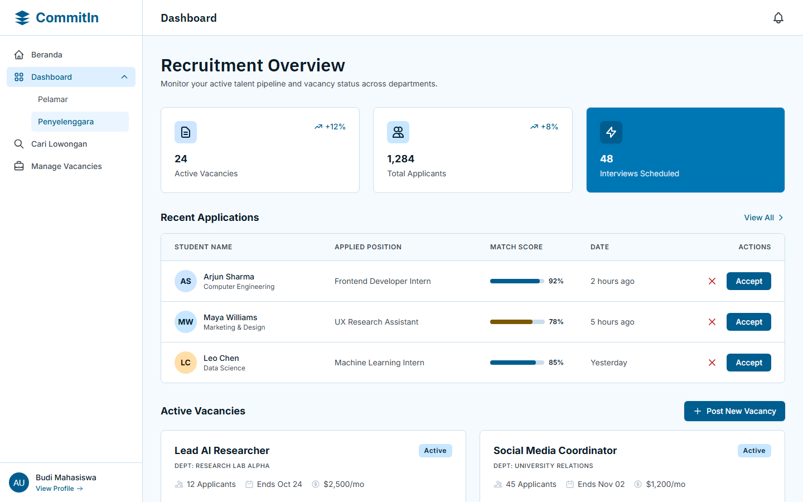
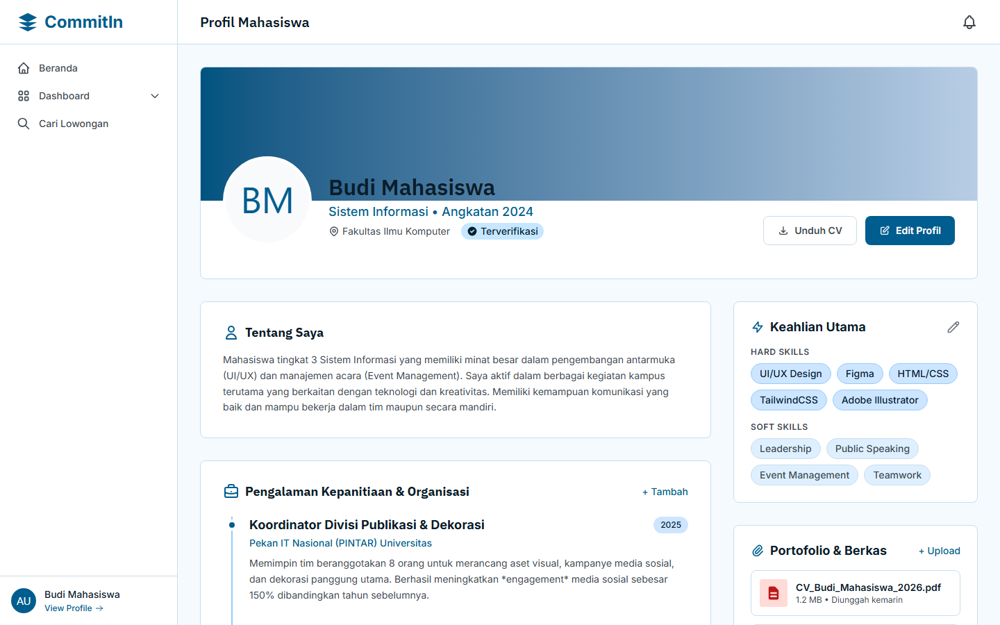

# CommitIn

Platform rekrutmen kepanitiaan dan organisasi kampus. Mahasiswa mencari lowongan BEM, HIMA, dan
panitia acara lalu memantau lamarannya; penyelenggara menyaring pelamar dan mengelola lowongan.

Proyek UAS Pemrograman Web, Teknologi Informasi Universitas Lambung Mangkurat (2026).
Saat ini berupa **prototipe antarmuka**: data di halaman masih statis.



## Halaman
| Halaman | URL |
|---|---|
| Beranda | `/` |
| Eksplorasi lowongan | `/explore` |
| Dashboard penyelenggara | `/dashboard` |
| Dashboard pelamar | `/pelamar` |
| Profil mahasiswa | `/profile` |

## Teknologi
Laravel 12 (PHP 8.2) · Blade · Tailwind CSS 4 · Vite

## Menjalankan
```bash
composer install
npm install && npm run build
cp .env.example .env
php artisan key:generate
php artisan serve
```
Buka http://127.0.0.1:8000

## Tampilan
| Eksplorasi | Dashboard penyelenggara | Profil |
|---|---|---|
|  |  |  |

Dibuat oleh Muhammad Nafis Putra.
